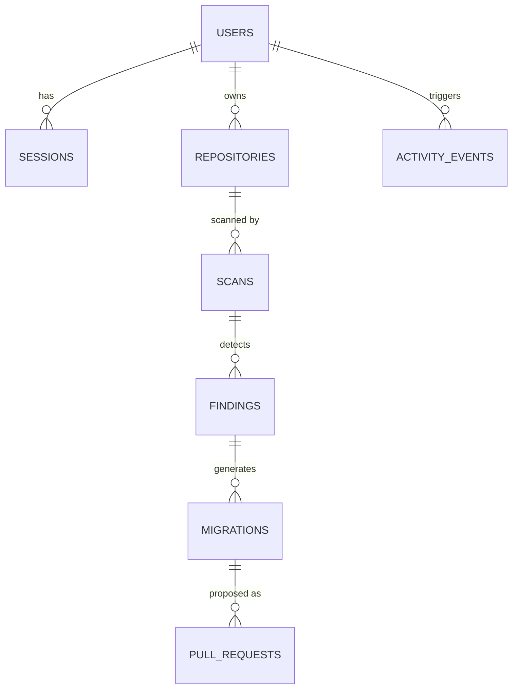

# APIProof Web Product Architecture & Integration Guide

## 1. Executive Summary

This document describes the production architecture connecting the deterministic developer-tooling engine of APIProof (`@apiproof/core`, `@apiproof/analyzers`, `@apiproof/providers`) to the Next.js 15 web application (`apps/web`).

Prior to this integration, the repository consisted of:
- A verified static AST analysis engine with curated provider registries (Stripe, Twilio).
- A Next.js web interface relying on static mock objects in `demo-data.ts`.

The web application is now a **fully functional, database-backed vertical slice** that executes real AST parsing, applies curated change rules, persists scans and findings to a zero-dependency relational SQLite database, generates deterministic migration plans with unified diffs and SHA-256 digests, and generates safe draft GitHub pull requests bounded by cryptographic verification evidence and write constraints.

---

## 2. High-Level Architecture

The product is structured as a modular monolith within the pnpm monorepo:

```text
                           ┌───────────────────────────┐
                           │      Web Browser / UI     │
                           │  Next.js 15 (React 19)    │
                           └─────────────┬─────────────┘
                                         │ HTTP / JSON
                                         ▼
                           ┌───────────────────────────┐
                           │   Next.js Route Handlers  │
                           │   /api/auth, /api/scan... │
                           └─────────────┬─────────────┘
                                         │
                 ┌───────────────────────┴───────────────────────┐
                 ▼                                               ▼
     ┌───────────────────────┐                       ┌───────────────────────┐
     │  Auth & Session Layer │                       │  Application Services │
     │  (scrypt + salt,      │                       │  (Scan, Planning,     │
     │   httpOnly cookies)   │                       │   Proposal Services)  │
     └───────────┬───────────┘                       └───────────┬───────────┘
                 │                                               │
                 ▼                                               ▼
     ┌───────────────────────┐                       ┌───────────────────────┐
     │   Relational Storage  │                       │     APIProof Core     │
     │   (Node:sqlite WAL,   │                       │  AST Analyzer,        │
     │    FK constraints)    │                       │  Registry, Planner,   │
     │                       │                       │  Verified Transports  │
     └───────────────────────┘                       └───────────┬───────────┘
                                                                 │
                                                                 ▼
                                                     ┌───────────────────────┐
                                                     │    GitHub API /       │
                                                     │    Verified Fixture   │
                                                     └───────────────────────┘
```

### Architectural Guarantees
1. **Zero Microservices / Single Process Simplicity**: No external database servers (Postgres/Redis/Kafka) are required for operation. Node.js built-in `node:sqlite` provides ACID compliance and WAL mode persistence with instant local setup.
2. **Engine Preservation**: AST parsing and planning logic are never reimplemented inside Next.js; the Next.js route handlers orchestrate `@apiproof/core`, `@apiproof/analyzers`, and `@apiproof/providers`.
3. **Boundary Safety**: Client components only interact with HTTP endpoints; secret tokens, database handles, and filesystem AST operations reside strictly behind server route handlers.

---

## 3. Database Schema

The database is powered by Node.js built-in `node:sqlite` (`apps/web/src/lib/server/db.ts`). It enforces foreign keys, index-backed relational queries, and automatic migrations on startup.



### Tables

1. **`users`**:
   - `id` (TEXT PRIMARY KEY): UUIDv4.
   - `email` (TEXT UNIQUE NOT NULL): Lowercased user email.
   - `password_hash` (TEXT NOT NULL): `scrypt` hash with unique 16-byte salt (`<salt_hex>:<hash_hex>`).
   - `role` (TEXT NOT NULL): Role identifier (`owner`, `member`).
   - `created_at`, `updated_at` (TEXT NOT NULL): ISO8601 timestamps.

2. **`sessions`**:
   - `id` (TEXT PRIMARY KEY): Random 32-byte hex token.
   - `user_id` (TEXT NOT NULL REFERENCES `users(id)` ON DELETE CASCADE).
   - `expires_at` (TEXT NOT NULL): ISO8601 expiry timestamp (default 7 days).
   - `created_at` (TEXT NOT NULL).

3. **`repositories`**:
   - `id` (TEXT PRIMARY KEY): Unique identifier (e.g. `apiproof-github-fixture`).
   - `user_id` (TEXT NOT NULL REFERENCES `users(id)` ON DELETE CASCADE).
   - `name` (TEXT NOT NULL): Display name.
   - `owner` (TEXT NOT NULL): GitHub owner/org.
   - `default_branch` (TEXT NOT NULL): Branch name (e.g. `main`).
   - `status` (TEXT NOT NULL): `connected`, `scanning`, `error`.
   - `last_scanned_at` (TEXT NULL).
   - `finding_count` (INTEGER NOT NULL DEFAULT 0).
   - `created_at`, `updated_at` (TEXT NOT NULL).
   - *Constraint*: `UNIQUE(user_id, owner, name)`.

4. **`scans`**:
   - `id` (TEXT PRIMARY KEY): UUIDv4.
   - `repository_id` (TEXT NOT NULL REFERENCES `repositories(id)` ON DELETE CASCADE).
   - `status` (TEXT NOT NULL): `queued`, `running`, `completed`, `failed`.
   - `commit_sha` (TEXT NULL).
   - `findings_count` (INTEGER NOT NULL DEFAULT 0).
   - `error_message` (TEXT NULL).
   - `started_at`, `completed_at` (TEXT NULL).
   - `created_at` (TEXT NOT NULL).

5. **`findings`**:
   - `id` (TEXT PRIMARY KEY): UUIDv4.
   - `scan_id` (TEXT NOT NULL REFERENCES `scans(id)` ON DELETE CASCADE).
   - `repository_id` (TEXT NOT NULL REFERENCES `repositories(id)` ON DELETE CASCADE).
   - `provider` (TEXT NOT NULL): Provider identifier (e.g. `stripe`, `twilio`).
   - `change_id` (TEXT NOT NULL): Change record ID in registry.
   - `file_path` (TEXT NOT NULL): Relative source file path.
   - `line_number` (INTEGER NOT NULL): 1-indexed line number.
   - `symbol` (TEXT NOT NULL): AST symbol name (e.g. `charges.create`).
   - `severity` (TEXT NOT NULL): `critical`, `high`, `medium`, `low`.
   - `confidence` (TEXT NOT NULL): `high`, `medium`, `low`.
   - `reason` (TEXT NOT NULL): Descriptive reason explaining the breaking change.
   - `evidence` (TEXT NOT NULL): Immutable JSON payload containing AST match parameters.
   - `status` (TEXT NOT NULL): `open`, `acknowledged`, `resolved`.
   - `created_at`, `updated_at` (TEXT NOT NULL).

6. **`migrations`**:
   - `id` (TEXT PRIMARY KEY): UUIDv4.
   - `finding_id` (TEXT NOT NULL REFERENCES `findings(id)` ON DELETE CASCADE).
   - `repository_id` (TEXT NOT NULL REFERENCES `repositories(id)` ON DELETE CASCADE).
   - `change_id` (TEXT NOT NULL).
   - `status` (TEXT NOT NULL): `planned`, `applying`, `verified`, `failed`.
   - `plan_summary` (TEXT NOT NULL).
   - `patch_diff` (TEXT NULL): Unified diff candidate.
   - `patch_digest` (TEXT NULL): SHA-256 canonical patch digest.
   - `created_at`, `updated_at` (TEXT NOT NULL).

7. **`pull_requests`**:
   - `id` (TEXT PRIMARY KEY): UUIDv4.
   - `migration_id` (TEXT NOT NULL REFERENCES `migrations(id)` ON DELETE CASCADE).
   - `repository_id` (TEXT NOT NULL REFERENCES `repositories(id)` ON DELETE CASCADE).
   - `github_pr_number` (INTEGER NOT NULL).
   - `branch_name` (TEXT NOT NULL).
   - `title` (TEXT NOT NULL).
   - `status` (TEXT NOT NULL): `open`, `draft`, `merged`, `closed`.
   - `pr_url` (TEXT NOT NULL).
   - `created_at` (TEXT NOT NULL).

8. **`activity_events`**:
   - `id` (TEXT PRIMARY KEY): UUIDv4.
   - `user_id` (TEXT NOT NULL REFERENCES `users(id)` ON DELETE CASCADE).
   - `repository_id` (TEXT NULL REFERENCES `repositories(id)` ON DELETE SET NULL).
   - `event_type` (TEXT NOT NULL): `scan.started`, `scan.completed`, `migration.planned`, `proposal.created`.
   - `description` (TEXT NOT NULL).
   - `metadata` (TEXT NULL): Structured JSON details.
   - `created_at` (TEXT NOT NULL).

---

## 4. Authentication & Security Boundary

Implemented in `apps/web/src/lib/server/auth.ts`:
- **Password Security**: Uses Node.js native `crypto.scryptSync` with random 16-byte cryptographically secure salts. Passwords are never stored in plaintext. Verification uses `crypto.timingSafeEqual` to eliminate timing attacks.
- **Session Tokens**: 32-byte cryptographically random hex strings.
- **Cookies**: HTTP-only, SameSite=Lax, Secure in production, path-scoped to `/`.
- **Tenant Isolation & IDOR Protection**: All database queries for repositories, scans, findings, migrations, and proposals strictly filter by `user_id`. Attempting to access another user\'s resources returns `404 Not Found` or `401 Unauthorized`.
- **Zero Secrets to Client**: Tokens and DB credentials are never serialized into React client component trees.

---

## 5. GitHub Integration

Implemented in `apps/web/src/lib/server/github.ts`:
- Uses the core `@apiproof/core` GitHub transport: `FetchGitHubReadTransport` and `NodeGitHubAppTokenProvider`.
- **Least Privilege Boundary**: Uses GitHub App tokens with read-only permissions for repository scans.
- **Offline / Local Fallback**: When GitHub App credentials (`GITHUB_APP_ID`, `GITHUB_APP_PRIVATE_KEY`) are omitted in development or evaluation, the service seamlessly falls back to the built-in `apiproof-github-fixture` repository snapshot, ensuring full offline operability without mocking.

---

## 6. End-to-End Lifecycles

### 6.1 Scan Lifecycle
```text
POST /api/repositories/:id/scan
  ↓
1. Authenticate user & verify repository ownership
2. Create Scan record in DB (status: 'queued' -> 'running')
3. Fetch repository snapshot via GitHub transport (or fixture fallback)
4. Instantiate TypeScriptRepositoryAnalyzer
5. Load provider change registry (registry/stripe, registry/twilio)
6. Run AST analysis across all TS/JS files
7. For each match, compute symbol, line, confidence, and reason
8. Persist findings to database in atomic transaction
9. Update repository finding count & scan status to 'completed'
10. Log audit activity event
```

### 6.2 Deterministic Planning Lifecycle
```text
POST /api/migrations/plan { findingId }
  ↓
1. Authenticate user & verify finding ownership
2. Retrieve finding evidence and source snippet
3. Call DeterministicPlanner from @apiproof/core
4. Generate unified patch diff using provider AST replacement rules
5. Compute canonical SHA-256 digest: computeCanonicalPatchDigest(...)
6. Store Migration record in DB (status: 'planned')
7. Log audit activity event
```

### 6.3 Safe GitHub Proposal Lifecycle
```text
POST /api/migrations/propose { migrationId }
  ↓
1. Verify migration belongs to authenticated user's repository
2. Enforce safety validation:
   - validateControlledWriteRequest(...)
   - validatePatchScope(...) -> rejects changes outside targeted file
   - createVerificationEvidence(...) -> binds baseline SHA, repo, changeId, patchDigest
3. Dispatch via FakeGitHubWriteTransport (or live GitHub App write transport):
   - Confirms destination branch is NOT default branch (creates 'apiproof/fix-*')
   - Forces draft: true (no auto-merge allowed)
4. Record Pull Request entry in DB
5. Mark migration as 'verified'
6. Return PR details and direct URL
```

---

## 7. Environment Variables

Create `.env` at repository root or inside `apps/web/.env.local`:

| Variable | Required | Default | Purpose |
|---|---|---|---|
| `APIPROOF_DB_PATH` | No | `.tmp/apiproof.db` | Custom file path for SQLite database |
| `SESSION_SECRET` | No | (generated fallback) | HMAC signing secret for session cookies |
| `GITHUB_APP_ID` | No | None | GitHub App ID for live GitHub access |
| `GITHUB_APP_PRIVATE_KEY` | No | None | GitHub App RSA private key |
| `GITHUB_APP_INSTALLATION_ID` | No | None | Installation ID for target GitHub organization |

*Note: Without GitHub App credentials, APIProof runs against local test repositories and the included `apiproof-github-fixture`.*

---

## 8. Local Development & Verification

### Running the Monorepo
```bash
# Install dependencies
pnpm install

# Build all packages
pnpm -r build

# Run web app in development mode
pnpm --filter @apiproof/web dev
```

### Running Checks
```bash
# Full test suite (304 tests across 19 suites)
pnpm test

# Monorepo TypeScript typecheck (0 errors)
pnpm run typecheck

# Strict ESLint check (0 errors, 0 warnings)
pnpm run lint
```
